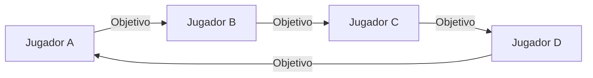
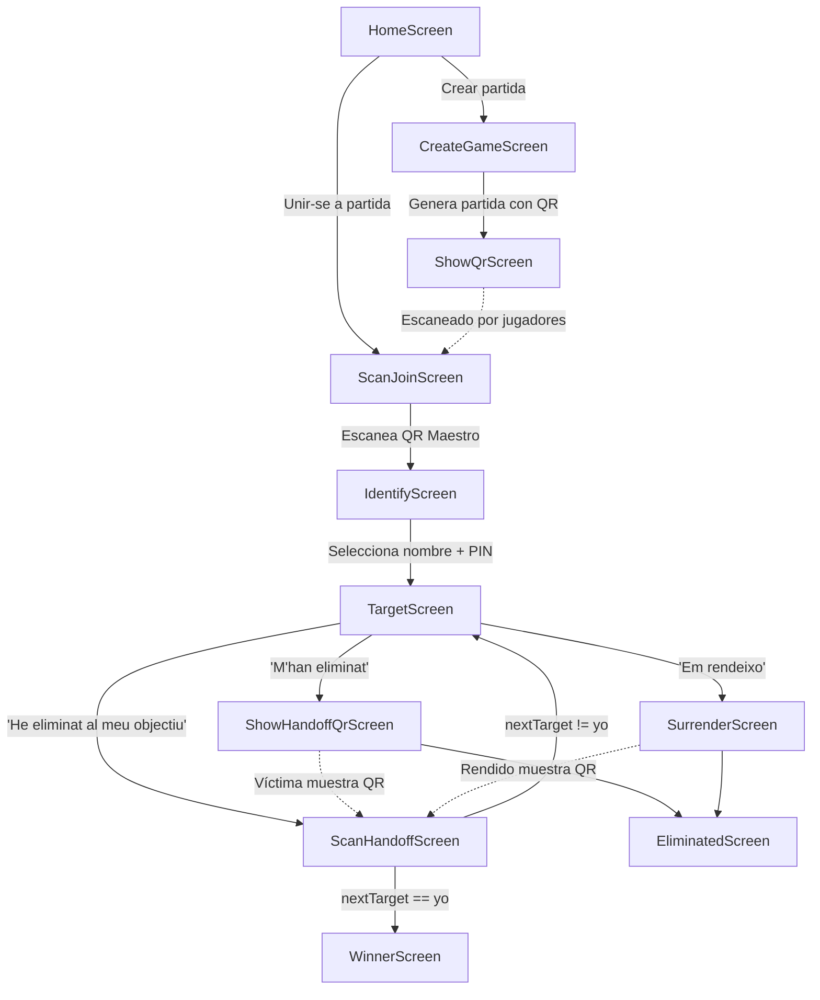
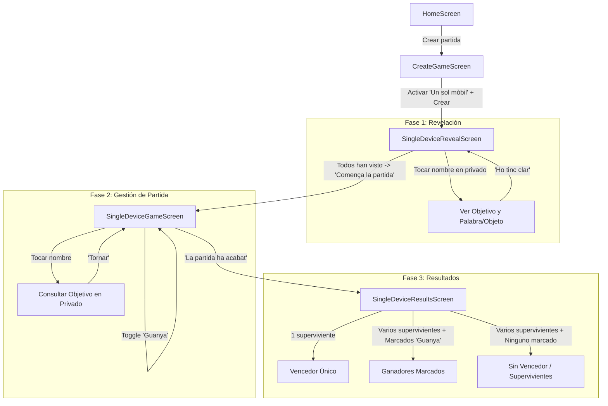

# Documentación de Petó Assassí 🗡️

**Petó Assassí** es una aplicación móvil desarrollada en Flutter diseñada para gestionar el clásico juego de rol en vivo del "asesino" o "killer" de forma **100% offline**, sin servidores centrales, sin internet y sin dependencias de conectividad local (Bluetooth ni Wi-Fi).

---

## Índice

1. [Visión General y Filosofía](#visión-general-y-filosofía)
2. [Modos de Partida](#modos-de-partida)
   - [A. Modo Multidispositivo (Códigos QR)](#a-modo-multidispositivo-códigos-qr)
   - [B. Modo Un Solo Móvil (Single Device)](#b-modo-un-solo-móvil-single-device)
3. [Mecánicas del Juego](#mecánicas-del-juego)
   - [La Cadena Circular de Asesinatos](#la-cadena-circular-de-asesinatos)
   - [Condiciones de Eliminación y Modos](#condiciones-de-eliminación-y-modos)
   - [Mecánica de Rendición ("Em rendeixo")](#mecánica-de-rendición-em-rendeixo)
   - [Mecánica de Traspaso y Condición de Victoria](#mecánica-de-traspaso-y-condición-de-victoria)
4. [Flujos de la Aplicación y Pantallas](#flujos-de-la-aplicación-y-pantallas)
   - [Diagrama de Flujo: Modo Multidispositivo](#diagrama-de-flujo-modo-multidispositivo)
   - [Diagrama de Flujo: Modo Un Solo Móvil](#diagrama-de-flujo-modo-un-solo-móvil)
   - [Detalle de Pantallas](#detalle-de-pantallas)
5. [Arquitectura Técnica y Criptografía](#arquitectura-técnica-y-criptografía)
   - [Estructura del Proyecto](#estructura-del-proyecto)
   - [Modelo de Datos](#modelo-de-datos)
   - [Protocolo Criptográfico y Formato de Payloads QR](#protocolo-criptográfico-y-formato-de-payloads-qr)
6. [Privacidad y Seguridad](#privacidad-y-seguridad)

---

## Visión General y Filosofía

En el juego tradicional del asesino, un organizador reparte papeles secretos con el nombre de la víctima de cada participante. Si alguien pierde su papel, o si un jugador eliminado no entrega su objetivo al asesino correspondiente, la partida puede bloquearse o perder consistencia.

**Petó Assassí** digitaliza y automatiza toda esta lógica asegurando:
1. **Privacidad estricta**: Ningún jugador (ni siquiera el organizador tras barajar) conoce el círculo completo de asesinatos.
2. **Cero infraestructura**: Funciona en cualquier lugar (casas rurales, excursiones, festivales, acampadas) mediante códigos QR cifrados o un único móvil compartido.
3. **Resiliencia ante abandonos**: Incorpora un sistema de rendición donde el jugador que abandona descubre a su cazador para cederle su objetivo y no quebrar la cadena.

---

## Modos de Partida

La aplicación soporta dos modalidades principales:

### A. Modo Multidispositivo (Códigos QR)
- **Requisitos**: Cada jugador tiene su propio teléfono móvil con la aplicación instalada.
- **Funcionamiento**:
  1. El creador (Master) añade los participantes y genera un **QR Maestro cifrado**.
  2. Cada jugador escanea el QR desde su propio móvil, selecciona su nombre e introduce su PIN secreto (si está activado).
  3. Cada móvil almacena **únicamente su propio estado** (su nombre, su objetivo actual y quién le persigue).
  4. Los asesinatos y traspasos de objetivos se confirman en persona escaneando códigos QR entre móviles.

### B. Modo Un Solo Móvil (Single Device)
- **Requisitos**: Un único teléfono para todo el grupo.
- **Funcionamiento**:
  1. El Master activa el switch **"Un sol mòbil"** al crear la partida.
  2. **Ronda de revelación**: El móvil va pasando de mano en mano; cada jugador toca su nombre en privado para ver a quién debe eliminar (y su palabra u objeto secreto) y pulsa "Ho tinc clar".
  3. **Panel de control en vivo**: Una pantalla accesible para el grupo o moderador permite:
     - Volver a consultar en privado el objetivo de cualquier jugador vivo.
     - Marcar jugadores como **Eliminados** a medida que caen.
     - Marcar jugadores como **Vencedores**.
  4. **Fin de partida**: Al pulsar "La partida ha acabat", la app calcula y muestra los supervivientes y determina el ganador o ganadores.

---

## Mecánicas del Juego

### La Cadena Circular de Asesinatos
El corazón del juego es un grafo dirigido en ciclo simple cerrado generado mediante `GameService.shuffle()`:
- Sean $N$ jugadores barajados al azar: $P_0 \to P_1 \to P_2 \to \dots \to P_{N-1} \to P_0$.
- Para cada jugador $P_i$:
  - **Su Objetivo** es $P_{(i+1) \bmod N}$.
  - **Su Cazador** (quien le persigue) es $P_{(i-1+N) \bmod N}$.



### Condiciones de Eliminación y Modos
Al crear la partida se define el método para cometer el asesinato:
- **Toque / Petó / Abrazo**: Hacer contacto físico o dar un beso en la mejilla sin testigos.
- **Robar objeto / Pañuelo / Pinza**: Quitarle una prenda u objeto sin que se dé cuenta.
- **Objeto asignado (`item`)**: La aplicación asigna automáticamente a cada cazador un objeto físico cotidiano (un tenedor, una flor, un boli, etc.). El cazador debe lograr entregar físicamente dicho objeto a su víctima.
- **Palabra secreta (`word`)**: La app asigna una palabra aleatoria. El asesino debe conseguir que su víctima pronuncie esa palabra en una conversación.
- **Texto personalizado**: Normas específicas fijadas por el grupo.

### Mecánica de Rendición ("Em rendeixo")
Si un jugador debe abandonar la partida o decide rendirse:
1. En su pantalla principal pulsa **"Em rendeixo"**.
2. **Confirmación de seguridad**: Se le advierte que quedará eliminado. Hasta que no pulsa *"Sí, em rendeixo"*, **la identidad de su cazador permanece oculta**.
3. **Revelación controlada**: Una vez confirmada la rendición:
   - Su estado cambia a `PlayerStatus.eliminated`.
   - La pantalla le muestra en grande: **"QUI ET VOLIA DONAR EL PETÓ: [Nombre del Cazador]"**.
   - Se muestra un código QR de traspaso idéntico al de eliminación.
4. El jugador busca a su cazador y le permite escanear el QR, transfiriendo su víctima al cazador sin interrumpir el ciclo de los demás jugadores.

### Mecánica de Traspaso y Condición de Victoria
Cuando el Cazador $A$ elimina a su Víctima $B$ (cuyo objetivo era $C$):
1. $B$ pulsa *"M'han eliminat"* (o *"Em rendeixo"*). Se genera un QR con `nextTarget: C`.
2. $A$ pulsa *"He eliminat al meu objectiu"* y escanea el QR de $B$.
3. La app de $A$ verifica que quien aparece en el QR coincide con su objetivo actual.
4. **Cálculo de Victoria**:
   - Si `nextTarget == A.myName`: La cadena se ha cerrado completamente. ¡$A$ es el **vencedor único**! Se muestra `WinnerScreen`.
   - Si `nextTarget != A.myName`: El nuevo objetivo de $A$ pasa a ser $C$, y el juego continúa.

---

## Flujos de la Aplicación y Pantallas

### Diagrama de Flujo: Modo Multidispositivo



### Diagrama de Flujo: Modo Un Solo Móvil



---

## Detalle de Pantallas

| Pantalla | Archivo | Descripción |
| :--- | :--- | :--- |
| **Splash** | [splash_screen.dart](file:///c:/Users/USER/Desktop/AppPhone/petoassassi/lib/screens/splash_screen.dart) | Animación inicial de carga con logo y comprobación de partida guardada en memoria local. |
| **Home** | [home_screen.dart](file:///c:/Users/USER/Desktop/AppPhone/petoassassi/lib/screens/home_screen.dart) | Menú principal: "Crear partida" o "Unir-se a partida". |
| **Crear Partida** | [create_game_screen.dart](file:///c:/Users/USER/Desktop/AppPhone/petoassassi/lib/screens/create_game_screen.dart) | Configuración de jugadores, switch de un solo móvil, switch de blindaje por PIN y selección de modo (toque, objeto, palabra, etc.). |
| **QR Maestro** | [show_qr_screen.dart](file:///c:/Users/USER/Desktop/AppPhone/petoassassi/lib/screens/show_qr_screen.dart) | Muestra el QR cifrado inicial con el listado completo y PINs para que todos lo escaneen. |
| **Escanear Entrada** | [scan_join_screen.dart](file:///c:/Users/USER/Desktop/AppPhone/petoassassi/lib/screens/scan_join_screen.dart) | Lector de cámara para capturar el QR inicial del Master. |
| **Identificación** | [identify_screen.dart](file:///c:/Users/USER/Desktop/AppPhone/petoassassi/lib/screens/identify_screen.dart) | Lista de nombres para reclamar identidad y validación con PIN de 4 dígitos. |
| **Objetivo Activo** | [target_screen.dart](file:///c:/Users/USER/Desktop/AppPhone/petoassassi/lib/screens/target_screen.dart) | Pantalla central del jugador vivo: muestra a quién matar, el objeto/palabra, y los 3 botones de acción (Cazar, Caer, Rendirse). |
| **Escanear Traspaso** | [scan_handoff_screen.dart](file:///c:/Users/USER/Desktop/AppPhone/petoassassi/lib/screens/scan_handoff_screen.dart) | Cámara del cazador para escanear el QR de su víctima o del que se ha rendido. |
| **Mostrar QR Muerte** | [show_handoff_qr_screen.dart](file:///c:/Users/USER/Desktop/AppPhone/petoassassi/lib/screens/show_handoff_qr_screen.dart) | Muestra el QR de traspaso cuando el jugador admite que ha sido eliminado. |
| **Rendición** | [surrender_screen.dart](file:///c:/Users/USER/Desktop/AppPhone/petoassassi/lib/screens/surrender_screen.dart) | Diálogo de confirmación, revelación de quién era su cazador y QR de traspaso. |
| **Eliminado** | [eliminated_screen.dart](file:///c:/Users/USER/Desktop/AppPhone/petoassassi/lib/screens/eliminated_screen.dart) | Pantalla de fuera de juego para participantes eliminados. |
| **Victoria** | [winner_screen.dart](file:///c:/Users/USER/Desktop/AppPhone/petoassassi/lib/screens/winner_screen.dart) | Pantalla de triunfo al cerrar el ciclo completo. |
| **Revelación (1 Móvil)** | [single_device_reveal_screen.dart](file:///c:/Users/USER/Desktop/AppPhone/petoassassi/lib/screens/single_device_reveal_screen.dart) | Consulta privada de objetivos por turnos con confirmación ("Ho tinc clar"). |
| **Juego (1 Móvil)** | [single_device_game_screen.dart](file:///c:/Users/USER/Desktop/AppPhone/petoassassi/lib/screens/single_device_game_screen.dart) | Panel de control en vivo para consultar objetivos, marcar eliminados y vencedores. |
| **Resultados (1 Móvil)**| [single_device_results_screen.dart](file:///c:/Users/USER/Desktop/AppPhone/petoassassi/lib/screens/single_device_results_screen.dart) | Resumen final con ganadores y lista de supervivientes. |

---

## Arquitectura Técnica y Criptografía

### Estructura del Proyecto

```
lib/
├── main.dart                               # Punto de entrada y resolución de estado previo
├── models/
│   ├── game_mode.dart                      # Definiciones de modos (toque, objeto, palabra...)
│   ├── game_state.dart                     # Estado local del móvil (myName, currentTarget, myHunter...)
│   └── player.dart                         # Modelo jugador (nombre y PIN)
├── services/
│   ├── crypto_service.dart                 # Cifrado simétrico AES-256-CBC de los códigos QR
│   ├── game_service.dart                   # Algoritmos de barajado circular y cálculo de objetivos
│   └── storage_service.dart                # Persistencia local con SharedPreferences
├── screens/                                # Pantallas y vistas de usuario
└── theme/                                  # Configuración de estilos y paleta de colores
```

### Protocolo Criptográfico y Formato de Payloads QR

Para evitar que los códigos QR puedan ser leídos con cualquier escáner de cámara o aplicación genérica de códigos QR, todos los payloads son cadenas JSON cifradas con **AES-256-CBC** con relleno PKCS#7 mediante `CryptoService`.

#### 1. Payload de Creación de Partida (`type: 'init'`)
Generado por `CreateGameScreen` y mostrado en `ShowQrScreen`:
```json
{
  "type": "init",
  "gameId": "1727289000",
  "gameMode": "Paraula secreta: fes que la digui",
  "requirePin": true,
  "players": [
    { "name": "Laia", "pin": "4812" },
    { "name": "Marc", "pin": "9134" },
    { "name": "Jordi", "pin": "2055" },
    { "name": "Anna", "pin": "7731" }
  ],
  "items": {
    "Laia": "Bicicleta",
    "Marc": "Paraigua",
    "Jordi": "Cafè",
    "Anna": "Guitarra"
  }
}
```

#### 2. Payload de Traspaso / Eliminación / Rendición (`type: 'handoff'`)
Generado por `ShowHandoffQrScreen` y `SurrenderScreen`:
```json
{
  "type": "handoff",
  "gameId": "1727289000",
  "eliminated": "Marc",
  "nextTarget": "Jordi",
  "nextItem": "Cafè"
}
```
Cuando `Laia` escanea este QR, la app verifica:
1. `payload['gameId'] == currentState.gameId` (pertenece a la misma partida).
2. `payload['eliminated'] == currentState.currentTarget` (solo puede escanear a su objetivo legítimo).
3. Actualiza el objetivo de Laia: `currentTarget = 'Jordi'`, y `assignedItem = 'Cafè'`.

---

## Privacidad y Seguridad

1. **Inexistencia de Servidor Central**:
   - No hay almacenamiento en la nube, ni registros de actividad centralizados, ni llamadas de red.
   - Es imposible interceptar datos vía red.
2. **Cálculo Descentralizado**:
   - Tras el escaneo inicial, cada dispositivo borra la lista completa de jugadores de la memoria y solo conserva su nombre, su objetivo directo y su cazador directo.
3. **Protección contra Spoofing de Identidad**:
   - En el modo con PIN blindado, ningún jugador puede reclamar el perfil de otro al unirse a la partida sin introducir el PIN asignado privadamente en el momento de crear la partida.
4. **Protección en Rendiciones**:
   - La aplicación bloquea la visualización del cazador hasta que se produce la confirmación irreversible de la rendición, imposibilitando que un jugador consulte quién le busca y luego continúe jugando con ventaja desleal.
